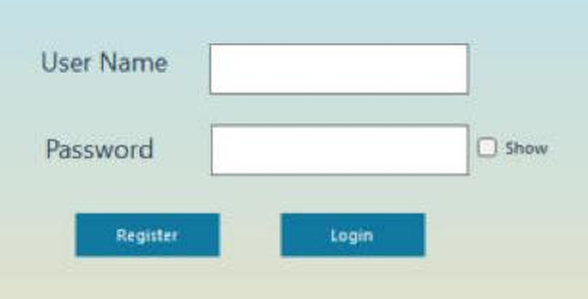
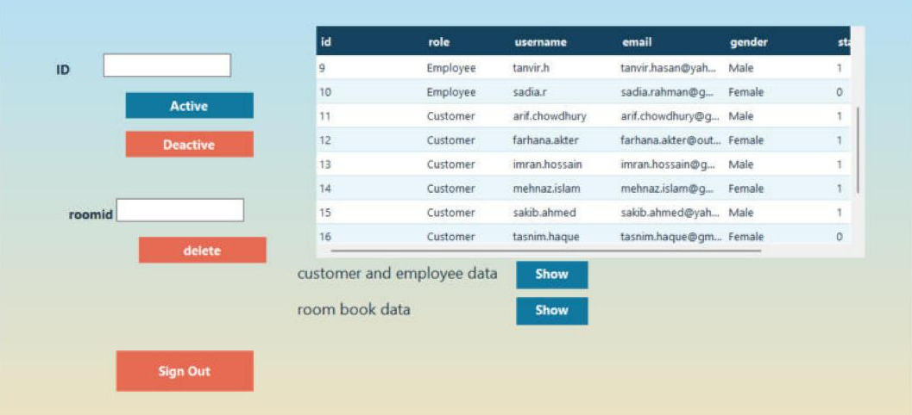
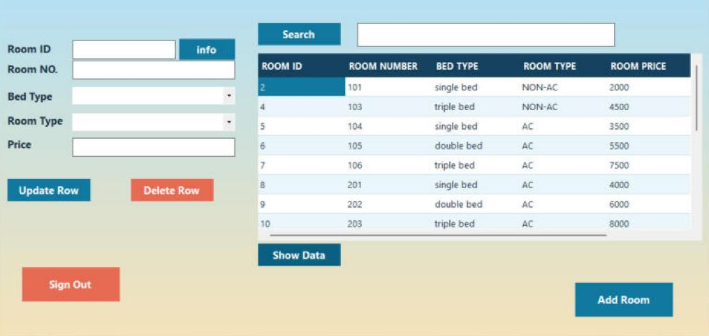
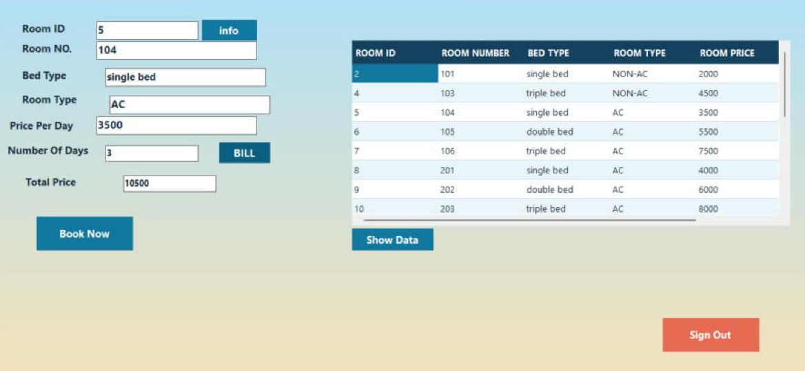

# Hotel Sea Beach — Hotel Management System

A Windows desktop application for running a small hotel: user accounts with roles, room management and room booking. Built with **C# (Windows Forms, .NET Framework 4.8)** and **Microsoft SQL Server**.

| Login | Manager |
|---|---|
|  |  |
| **Employee** | **Customer** |
|  |  |

## Features

### Three roles, each with its own screen
| Role | Can do |
|---|---|
| **Manager** | View all users, activate or deactivate Employee and Customer accounts, view all bookings, delete a room together with its bookings |
| **Employee** | Add, update, search and delete rooms |
| **Customer** | View rooms, calculate the price of a stay, book an available room |

### Account approval
New Employee and Customer accounts are inactive until a Manager activates them. Only the very first account can register as Manager (to set up the hotel); after that, the Manager role is refused on the signup screen.

### Booking without double booking
Marking a room as booked and saving the booking happen in **one database transaction**, and the room is only marked if it is still free. Two customers can never book the same room.

### Signup validation
| Field | Rule |
|---|---|
| Username | 4-20 characters, starts with a letter, then letters, numbers or `_` |
| Password | At least 8 characters, at least one letter and one number, must not contain the username; hidden while typing |
| Email | Valid format, e.g. `name@example.com` |
| Mobile | Bangladeshi number, e.g. `01712345678` (`+880` accepted) |
| Date of birth | Not in the future; at least 18 years old |
| Address | At least 5 characters |
| Uniqueness | Username, email and mobile must not already be registered |

All problems are listed together in one message so the user can fix them at once. Rooms are validated too: required fields, unique room numbers and whole-number prices.

## Security

- **Parameterized SQL queries everywhere.** User input is never joined into SQL text, so it cannot change a query (no SQL injection).
- **Hashed passwords.** Salted PBKDF2-SHA256 with 100,000 iterations, compared in constant time. Plain-text passwords are never stored.
- **Automatic upgrade of old accounts.** An account created before hashing is checked once on its next login and its password is replaced by a hash.
- **Login history without passwords.** Only the username and login time are recorded.
- **Configuration outside the code.** The database connection string lives in `App.config`.

## Database

SQL Server database `LoginDB`:

| Table | Holds |
|---|---|
| `registrationone` | User accounts: role, username, password hash, email, mobile, date of birth, gender, address, active status |
| `addroom` | Rooms: number, bed type, room type, price per day, booked flag |
| `Customerroombook` | Bookings: room, number of days, price per day, total price |
| `LoginHistory` | Username and time of each login |

## Getting started

### Requirements
- Windows 10 or 11 (.NET Framework 4.8 is built in)
- [SQL Server Express](https://www.microsoft.com/sql-server/sql-server-downloads) (free), instance name `SQLEXPRESS`
- Optional: Visual Studio 2022 Community with the **.NET desktop development** workload (needed only to edit the form layouts)

### 1. Create the database
Open `database/create-database.sql` in SQL Server Management Studio and click **Execute**, or run:

```bat
sqlcmd -S .\SQLEXPRESS -E -C -i database\create-database.sql
```

Upgrading a database from the earlier version of this app? Run `database/migrate.sql` instead.

### 2. Build and run
**With Visual Studio:** open `hotelseabeach.sln` and press **F5**.

**Without Visual Studio:** double-click `build.bat`, then run `bin\Release\hotelseabeach.exe`.

If your SQL Server instance is not `.\SQLEXPRESS`, change the `HotelDb` connection string in `App.config` (or `bin\Release\hotelseabeach.exe.config` after building).

### 3. First login
Click **Register**, create an account with the role **Manager**, and log in. Then register Employee and Customer accounts and activate them from the Manager screen.

## Project structure

```
loginpage.cs          Login, role routing, password check and upgrade
registrationpage.cs   Signup screen
SignupValidator.cs    Signup rules (username, password, email, mobile, age, address)
managerform.cs        Manager screen: accounts and bookings
Employeeform.cs       Employee screen: rooms
clientpage.cs         Customer screen: rooms, price, booking
PasswordHasher.cs     PBKDF2 password hashing and verification
Db.cs                 Database connection from App.config
database/             create-database.sql, migrate.sql, seed-demo-data.sql
screenshots/          README images
build.bat             Build without Visual Studio
```

## Tech stack

C#, Windows Forms, .NET Framework 4.8, ADO.NET (`System.Data.SqlClient`), Microsoft SQL Server, T-SQL.
